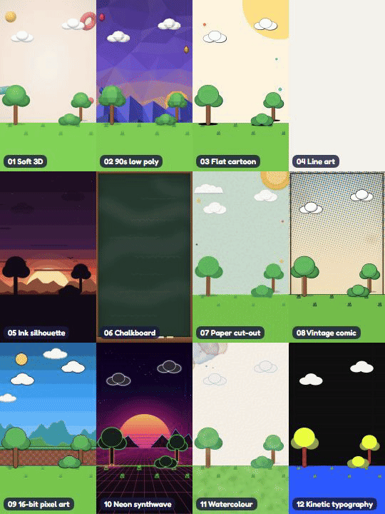
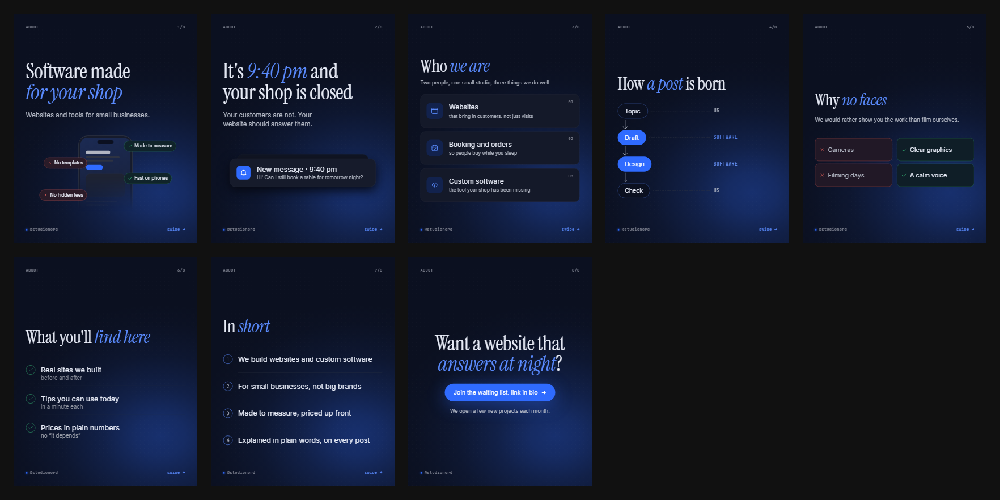

# unfaced

**Create and run faceless social media pages with your coding agent.**

**Read this in:** English · [Italiano](docs/i18n/it/README.md) · [Español](docs/i18n/es/README.md) · [Français](docs/i18n/fr/README.md) · [Português (Brasil)](docs/i18n/pt-BR/README.md)

Pick numbered styles, script types, hooks and voices, save them in a page profile, and turn one-line ideas into finished vertical videos for Reels, TikTok and Shorts, or into still posts (carousels, single images, LinkedIn PDFs, stories) in a brand's look. Free by default; paid services are optional.



## What you can do

Ask your agent, in your own words:

| You say | What happens |
|---|---|
| "Start a faceless TikTok page about surprising cat facts, in English" | **page-setup** asks a few questions (or picks everything if you say "you choose"), writes `page.yaml` from the numbered catalogs, and can build a mascot that looks the same in every video. |
| "Give me ideas for next week" | **video-ideas** writes ten checked ideas, two or three recurring series and a calendar into `ideas.md`; each idea says whether it is a reel, a carousel or a story, and why. |
| "How should I make the one about kneading?" | **video-recommend** offers 2–3 combinations (script type, hook, ending, length...) with a sample hook for each. |
| "Make it" | **video-make** researches and writes the script, **stops for your approval**, then records the voice, draws the scenes, renders, runs the automatic checks and has an independent reviewer agent look at every frame before handing you `video.mp4`. |
| "Make a carousel about our three services" | **post-make** writes the text slide by slide, **stops for your approval**, then renders the slides (and a PDF for LinkedIn), checks them and has an independent reviewer agent look at every one. |
| "Here are screenshots of our profile" | **page-setup** reads them and drafts the page's profile, brand included (handle, colours, fonts, tone), then asks about what it can't settle. Nothing is saved until you agree. |
| "Get it ready to post" | **video-package** renders `cover.png` and writes `post.md`: captions, hashtags and a title for each platform. |
| "Here are my numbers, what should I change?" | **page-results** compares the videos in `results.md` by platform and by every choice they made, and suggests at most three changes, each with a way to test it. |

unfaced never posts anything. It makes files; you, or your own scheduling tool, publish them.

## Install

**Never used a terminal?** Follow [Getting started, no coding needed](docs/guide/getting-started.md): the Claude desktop app, a folder and a few sentences to Claude.

**Claude Code** (first-class):

```text
/plugin marketplace add dodoshell/unfaced
/plugin install unfaced@unfaced
```

The first command that needs the engine installs it into `~/.unfaced/` (git, Node 22+ and about 1 GB for the voice model, whisper and the render browser).

**Other agents** (best effort): `npx skills add dodoshell/unfaced`. The skills are plain instructions and a Node launcher; where an agent has no subagents, the review runs in a fresh session instead.

**From a clone**: `npm run setup`, then use the CLI directly (below). The skills inside the clone use it; to point an installed plugin at your clone, set `UNFACED_LIB` to its folder.

## Catalogs

Every entry is ready to use. `unfaced list <kind>` lists a catalog, `unfaced show <kind> <number>` prints an entry's guide, and `unfaced gallery` builds a page that shows them all, with a poster of every style.

| Catalog | Entries |
|---|---|
| Styles (13) | soft 3D, 90s low poly, flat cartoon, line art, ink silhouette, chalkboard, paper cut-out, vintage comic, 16-bit pixel art, neon synthwave, watercolour, kinetic typography; and 13 Night tech, which draws posts (videos are planned) |
| Post types (6) | tips and mistakes, how it works, about us, services and prices, before and after, announcement |
| Script types (10) | build it, top N countdown, myth or fact, what if, story in 60 seconds, surprising answer, how it works, X vs Y, did you know, mini story |
| Hooks (15) | shocking question, absurd number, "you're doing it wrong", impossible image, POV, start at the climax... each with rules and three examples |
| Voices (8) | calm documentary, energetic, storyteller, whisper, deadpan, warm friendly, news anchor, none (text only) |
| Captions (6) | word-by-word karaoke, bold centre, typewriter, minimal lower third, outline pop, highlight keyword |
| Music (8) | suspense, epic, lo-fi, upbeat, playful, emotional, mystery (all made in code, MIT), none |
| Endings (6) | seamless loop, cliffhanger, comment question, follow for part 2, punchline, callback to the hook |
| Durations (4) | 15, 30, 45 and 60 seconds, with pacing rules |

## Posts

A post is a folder with a `slides.md`: the text, slide by slide. unfaced lays it out in the page's style and brand and renders PNGs, plus a PDF for LinkedIn and a `grid.png` to see them side by side.



Name the format by what the post is for; unfaced knows the size:

| Format | Size | Slides | You get |
|---|---|---|---|
| `instagram-carousel` | 1080×1350 | 2 to 10 | PNGs |
| `instagram-post` | 1080×1350 (1080×1080 with `square: true`) | 1 | a PNG |
| `linkedin-carousel` | 1080×1350 | 2 to 12 | a PDF, and the PNGs |
| `story` | 1080×1920 | 1 to 10 | PNGs |

One `slides.md` can be made in several formats; the layouts reflow and the text stays. A page's brand (handle, site, logo, fonts, tone, words to use and to avoid) appears on the slides and guides every text the agents write. Slide kinds: cover, point, list, steps, compare, stat, quote, image, cta, and custom for a slide that needs its own code. See `unfaced docs slides` and `unfaced docs brand`.

Style 13 Night tech is the first style that draws posts, with drawn visuals ready to use: chips, a step flow, a phone, a notification card and a small icon set. Styles 1 to 12 make videos only for now. A complete page with a carousel: [`examples/pages/studio-nord/`](examples/pages/studio-nord/).

## Examples

- [`examples/pages/`](examples/pages/): four pages to copy. *Studio Nord* (night tech, a small web studio) has a brand block and an "about us" carousel in `posts/about-us/`. *Curious Cats* (flat cartoon, cat facts) with two made videos: their scripts, word timings, plans and check results, ready to render again with `unfaced make`; *Space in 60* (neon synthwave, one big space idea a minute, cliffhangers) and *Piccola Storia* (watercolour, in Italian: the small stories behind everyday words and objects), each with a mascot, ideas and a calendar.
- [`examples/combos/`](examples/combos/): five sample videos of about 30 seconds; no two share a style, script type, hook, voice, caption style, music mood or ending. The scripts, plans and checks are here; the MP4s are attached to each release.
- [`examples/scripts/`](examples/scripts/): one complete `script.md` for each script type.
- [`examples/hooks/`](examples/hooks/): every hook with three examples from different niches. The hook reel, each hook spoken over the next style, is attached to each release.

## How it works

- **Free and local**: `script.md` → voice (Kokoro, offline; English and Italian first-class) → word timings (whisper.cpp) → frame-accurate scenes → music mixed under the voice → a 1080×1920, 30 fps MP4 rendered with Remotion. No API key, no GPU.
- **Paid only if you want it**: ElevenLabs for the voice, Pexels (a free key) for stock photos, Replicate for generated images and clips (`unfaced generate`). Keys go in `.env`, never in `page.yaml`; without a key the free path is used and unfaced says so.
- **A character system**: eight species and ten poses, the same motion in every style, so a page's mascot stays on-model.
- **A video's own scenes**: when a beat needs a diagram or a specific moment, the agent writes a small React scene for it (`docs/formats/scenes.md`); everything else uses the style's scenes.
- **Two reviews**: automatic checks (overlapping text, the platforms' safe zone, captions in sync with the voice within 2 frames, black or frozen frames, loudness, cut words) and an independent reviewer agent that sees only the files, never the conversation that made the video.

## The CLI

```bash
npm run unfaced -- page examples/pages/curious-cats            # check a page profile
npm run unfaced -- make examples/pages/curious-cats/videos/why-cats-purr
npm run unfaced -- frames examples/pages/curious-cats/videos/why-cats-purr --every 1s
npm run unfaced -- cover examples/pages/curious-cats/videos/why-cats-purr
npm run unfaced -- post examples/pages/studio-nord/posts/about-us      # render a carousel (--format <name> for one format)
npm run unfaced -- demo 13 --post                              # the sample post in a style
npm run unfaced -- results my-page                             # compare the posted videos' numbers (results.md)
npm run unfaced -- docs slides                                 # file formats: page, brand, script, slides, mascot, scenes, review, post, results
npm run unfaced -- list post-type                              # the post types
npm run unfaced -- doctor                                      # what is missing from the install
npm run unfaced -- help                                        # every command
```

The skills and the reviewer agent have evals in [`evals/`](evals/README.md), run with `claude plugin eval`.

## A page on disk

```text
my-page/
  page.yaml              the profile: language, niche, style, script types, voice, ...
  brand/                 optional: logo, fonts, and mascot/ (mascot.json, mascot.md, reference.png)
  ideas.md               ideas, series and the calendar
  results.md             how the posted videos did
  videos/
    why-cats-purr/
      script.md          hook, body beats, ending (docs/formats/script.md)
      scenes/            optional scene code for this video
      inbox/             optional images, clips or a voice-over you hand off
      video.mp4          made by unfaced make
      check.json         the automatic checks
      review.md          the independent review
      cover.png, post.md ready to post
  posts/
    about-us/
      slides.md          the text, slide by slide (docs/formats/slides.md)
      custom/, inbox/   optional slide code and photos
      slide-01.png ...   made by unfaced post (post.pdf for LinkedIn, grid.png, check.json)
      review.md, post.md the independent review; captions, hashtags and alt text
```

## Contributing

New styles, script types, post types, slide kinds and hooks are welcome: see [`CONTRIBUTING.md`](CONTRIBUTING.md).

## License

MIT. Third-party assets keep their own licences, listed in [`LICENSES/`](LICENSES/README.md).
Rendering uses [Remotion](https://www.remotion.dev), which is free for individuals and companies of up to three people; larger companies need a [Remotion licence](https://www.remotion.dev/license).
