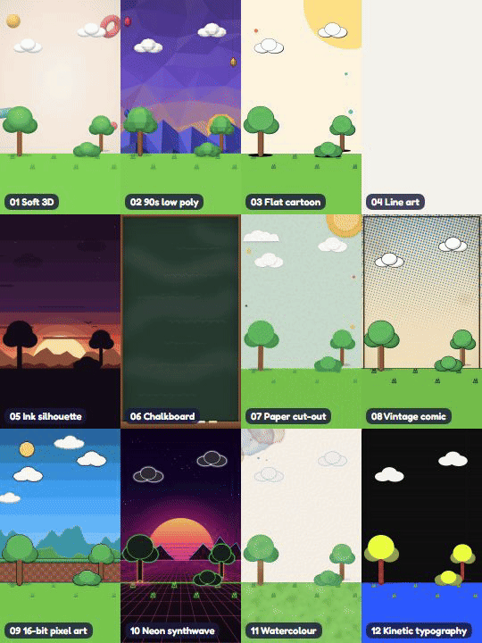
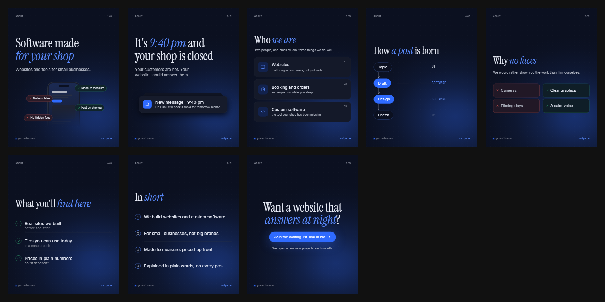

# unfaced

*Esta es una traducción; si difiere de la [versión en inglés](../../../README.md), la versión en inglés es la que está al día.*

**Crea y gestiona páginas faceless para redes sociales con tu agente de programación.**

**Léelo en:** [English](../../../README.md) · [Italiano](../it/README.md) · Español · [Français](../fr/README.md) · [Português (Brasil)](../pt-BR/README.md)

Elige estilos, tipos de guion, ganchos y voces numerados, guárdalos en el perfil de una página y convierte ideas de una línea en videos verticales terminados para Reels, TikTok y Shorts, o en publicaciones fijas (carruseles, imágenes sueltas, PDF para LinkedIn, historias) con el estilo de una marca. Gratis por defecto; los servicios de pago son opcionales.



## Qué puedes hacer

Pídeselo a tu agente, con tus propias palabras:

| Tú dices | Qué pasa |
|---|---|
| "Crea una página faceless de TikTok sobre datos sorprendentes de gatos, en español" | **page-setup** te hace unas cuantas preguntas (o lo elige todo si dices "elige tú"), escribe `page.yaml` a partir de los catálogos numerados y puede crear una mascota que se vea igual en todos los videos. |
| "Dame ideas para la próxima semana" | **video-ideas** escribe diez ideas verificadas, dos o tres series recurrentes y un calendario en `ideas.md`. Cada idea dice si es un reel, un carrusel o una historia, y por qué. |
| "¿Cómo debería hacer el del amasado?" | **video-recommend** te propone 2–3 combinaciones (tipo de guion, gancho, final, duración...) con un gancho de ejemplo para cada una. |
| "Hazlo" | **video-make** investiga y escribe el guion, **se detiene para que lo apruebes**, y luego graba la voz, dibuja las escenas, renderiza, pasa los controles automáticos y hace que un agente revisor independiente mire cada fotograma antes de entregarte `video.mp4`. |
| "Haz un carrusel sobre nuestros tres servicios" | **post-make** escribe el texto diapositiva por diapositiva, **se detiene para que lo apruebes**, y luego crea las diapositivas (y un PDF para LinkedIn), pasa los controles y hace que un agente revisor independiente mire cada una. |
| "Aquí tienes capturas de nuestro perfil" | **page-setup** las lee y prepara un borrador del perfil de la página, marca incluida (handle, colores, fuentes, tono), y luego te pregunta lo que no puede decidir solo. No guarda nada hasta que estés de acuerdo. |
| "Déjalo listo para publicar" | **video-package** renderiza `cover.png` y escribe `post.md`: textos, hashtags y un título para cada plataforma. |
| "Aquí tienes mis números, ¿qué debería cambiar?" | **page-results** compara los videos de `results.md` por plataforma y por cada elección que se hizo en ellos, y te sugiere como máximo tres cambios, cada uno con una forma de ponerlo a prueba. |

unfaced nunca publica nada. Crea archivos; tú, o tu propia herramienta de programación de publicaciones, los publican.

## Instalación

**¿Nunca has usado una terminal?** Sigue [Primeros pasos, sin programar](getting-started.md): la app de escritorio de Claude, una carpeta y unas cuantas frases a Claude.

**Claude Code** (soporte principal):

```text
/plugin marketplace add dodoshell/unfaced
/plugin install unfaced@unfaced
```

El primer comando que necesita el motor lo instala en `~/.unfaced/` (git, Node 22+ y alrededor de 1 GB para el modelo de voz, whisper y el navegador de renderizado).

**Otros agentes** (sin garantías): `npx skills add dodoshell/unfaced`. Las skills son instrucciones en texto plano y un lanzador de Node; si un agente no tiene subagentes, la revisión se hace en una sesión nueva.

**Desde un clon**: `npm run setup` y luego usa la CLI directamente (más abajo). Las skills dentro del clon la usan; para que un plugin instalado apunte a tu clon, define `UNFACED_LIB` con su carpeta.

## Catálogos

Todas las entradas están listas para usar. `unfaced list <kind>` lista un catálogo, `unfaced show <kind> <number>` muestra la guía de una entrada y `unfaced gallery` genera una página que las muestra todas, con un póster de cada estilo.

| Catálogo | Entradas |
|---|---|
| Estilos (13) | 3D suave, low poly de los 90, cartoon plano, line art, silueta en tinta, pizarra, recortes de papel, cómic vintage, pixel art de 16 bits, synthwave neón, acuarela, tipografía cinética; y el 13 Night tech, que dibuja publicaciones (los videos están previstos) |
| Tipos de publicación (6) | consejos y errores, cómo funciona, quiénes somos, servicios y precios, antes y después, anuncio |
| Tipos de guion (10) | constrúyelo, top N en cuenta atrás, mito o realidad, qué pasaría si, una historia en 60 segundos, respuesta sorprendente, cómo funciona, X vs Y, ¿sabías que...?, mini historia |
| Ganchos (15) | pregunta impactante, número absurdo, "lo estás haciendo mal", imagen imposible, POV, empezar por el clímax... cada uno con sus reglas y tres ejemplos |
| Voces (8) | documental tranquila, enérgica, narradora, susurro, impasible, cálida y cercana, presentador de noticias, ninguna (solo texto) |
| Subtítulos (6) | karaoke palabra por palabra, negrita al centro, máquina de escribir, rótulo inferior minimalista, contorno pop, palabra clave resaltada |
| Música (8) | suspense, épica, lo-fi, alegre, juguetona, emotiva, misterio (toda hecha con código, MIT), ninguna |
| Finales (6) | bucle perfecto, cliffhanger, pregunta para comentarios, sígueme para la parte 2, remate, vuelta al gancho |
| Duraciones (4) | 15, 30, 45 y 60 segundos, con reglas de ritmo |

## Publicaciones

Una publicación es una carpeta con un `slides.md`: el texto, diapositiva por diapositiva. unfaced lo maqueta con el estilo y la marca de la página y crea las diapositivas en PNG, además de un PDF para LinkedIn y una `grid.png` para verlas todas juntas.



Indica el formato según para qué sirve la publicación; el tamaño ya lo conoce unfaced:

| Formato | Tamaño | Diapositivas | Obtienes |
|---|---|---|---|
| `instagram-carousel` | 1080×1350 | de 2 a 10 | PNG |
| `instagram-post` | 1080×1350 (1080×1080 con `square: true`) | 1 | un PNG |
| `linkedin-carousel` | 1080×1350 | de 2 a 12 | un PDF, y los PNG |
| `story` | 1080×1920 | de 1 a 10 | PNG |

Un mismo `slides.md` se puede crear en varios formatos: el diseño se adapta y el texto no cambia. La marca de la página (handle, sitio web, logo, fuentes, tono, palabras que usar y que evitar) pone su handle, su logo y sus fuentes en las diapositivas y guía todos los textos que escriben los agentes, pies de publicación incluidos, donde va el sitio web. Tipos de diapositiva: cover, point, list, steps, compare, stat, quote, image, cta y custom, para una diapositiva que necesita su propio código. Mira `unfaced docs slides` y `unfaced docs brand`.

El 13 Night tech es el primer estilo que dibuja publicaciones, con elementos gráficos listos para usar: chips, un flujo de pasos, un teléfono, una notificación y un pequeño juego de iconos. Los estilos del 1 al 12 de momento solo hacen videos. Una página completa con un carrusel: [`examples/pages/studio-nord/`](../../../examples/pages/studio-nord/).

## Ejemplos

- [`examples/pages/`](../../../examples/pages/): cuatro páginas para copiar. *Studio Nord* (night tech, un pequeño estudio web) tiene un bloque de marca y un carrusel "quiénes somos" en `posts/about-us/`. *Curious Cats* (cartoon plano, datos de gatos) con dos videos hechos: sus guiones, tiempos de cada palabra, planes y resultados de los controles, listos para renderizar de nuevo con `unfaced make`; *Space in 60* (synthwave neón, una gran idea del espacio por minuto, cliffhangers) y *Piccola Storia* (acuarela, en italiano: las pequeñas historias detrás de palabras y objetos cotidianos), cada una con mascota, ideas y calendario.
- [`examples/combos/`](../../../examples/combos/): cinco videos de muestra de unos 30 segundos; no hay dos que compartan estilo, tipo de guion, gancho, voz, estilo de subtítulos, tipo de música o final. Aquí están los guiones, planes y controles; los MP4 van adjuntos a cada release.
- [`examples/scripts/`](../../../examples/scripts/): un `script.md` completo para cada tipo de guion.
- [`examples/hooks/`](../../../examples/hooks/): todos los ganchos con tres ejemplos de nichos distintos. El reel de ganchos, con cada gancho narrado sobre el estilo siguiente, va adjunto a cada release.

## Cómo funciona

- **Gratis y en local**: `script.md` → voz (Kokoro, sin conexión; inglés e italiano con soporte completo) → tiempos de cada palabra (whisper.cpp) → escenas sincronizadas al fotograma → música mezclada bajo la voz → un MP4 de 1080×1920 a 30 fps renderizado con Remotion. Sin API key, sin GPU.
- **De pago solo si lo quieres**: ElevenLabs para la voz, Pexels (con una clave gratuita) para fotos de stock, Replicate para imágenes y clips generados (`unfaced generate`). Las claves van en `.env`, nunca en `page.yaml`; sin clave se usa la opción gratuita y unfaced te lo dice.
- **Un sistema de personajes**: ocho especies y diez poses, con el mismo movimiento en todos los estilos, para que la mascota de una página siempre se vea igual.
- **Escenas propias para cada video**: cuando un momento necesita un diagrama o algo muy concreto, el agente escribe una pequeña escena en React para él (`docs/formats/scenes.md`); todo lo demás usa las escenas del estilo.
- **Dos revisiones**: controles automáticos (texto que se superpone, la zona segura de las plataformas, subtítulos sincronizados con la voz con un margen de 2 fotogramas, fotogramas negros o congelados, volumen, palabras cortadas) y un agente revisor independiente que solo ve los archivos, nunca la conversación con la que se hizo el video.

## La CLI

```bash
npm run unfaced -- page examples/pages/curious-cats            # check a page profile
npm run unfaced -- make examples/pages/curious-cats/videos/why-cats-purr
npm run unfaced -- frames examples/pages/curious-cats/videos/why-cats-purr --every 1s
npm run unfaced -- cover examples/pages/curious-cats/videos/why-cats-purr
npm run unfaced -- post examples/pages/studio-nord/posts/about-us      # render a carousel (--format <name> for one format)
npm run unfaced -- demo 13 --post                              # the sample post in a style
npm run unfaced -- results my-page                             # compare the posted videos' numbers (results.md)
npm run unfaced -- docs slides                                 # file formats: page, brand, script, slides, mascot, scenes, review, post, results
npm run unfaced -- list post-type                              # the post types
npm run unfaced -- doctor                                      # what is missing from the install
npm run unfaced -- help                                        # every command
```

Las skills y el agente revisor tienen evals en [`evals/`](../../../evals/README.md), que se ejecutan con `claude plugin eval`.

## Una página en disco

```text
my-page/
  page.yaml              the profile: language, niche, style, script types, voice, ...
  brand/                 optional: logo, fonts, and mascot/ (mascot.json, mascot.md, reference.png)
  ideas.md               ideas, series and the calendar
  results.md             how the posted videos did
  videos/
    why-cats-purr/
      script.md          hook, body beats, ending (docs/formats/script.md)
      scenes/            optional scene code for this video
      inbox/             optional images, clips or a voice-over you hand off
      video.mp4          made by unfaced make
      check.json         the automatic checks
      review.md          the independent review
      cover.png, post.md ready to post
  posts/
    about-us/
      slides.md          the text, slide by slide (docs/formats/slides.md)
      custom/, inbox/   optional slide code and photos
      slide-01.png ...   made by unfaced post (post.pdf for LinkedIn, grid.png, check.json)
      review.md, post.md the independent review; captions, hashtags and alt text
```

## Contribuir

Los nuevos estilos, tipos de guion, tipos de publicación, tipos de diapositiva y ganchos son bienvenidos: consulta [`CONTRIBUTING.md`](../../../CONTRIBUTING.md).

## Licencia

MIT. Los recursos de terceros mantienen sus propias licencias, listadas en [`LICENSES/`](../../../LICENSES/README.md).
El renderizado usa [Remotion](https://www.remotion.dev), que es gratuito para particulares y empresas de hasta tres personas; las empresas más grandes necesitan una [licencia de Remotion](https://www.remotion.dev/license).
