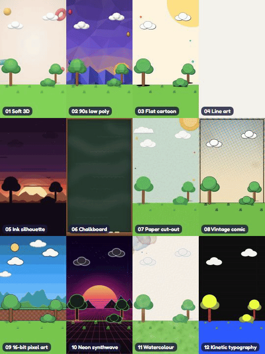

# unfaced

*Ceci est une traduction ; en cas de différence avec [la version anglaise](../../../README.md), c'est la version anglaise qui fait foi.*

**Créez et animez des pages faceless sur les réseaux sociaux avec votre agent de code.**

**Lire en :** [English](../../../README.md) · [Italiano](../it/README.md) · [Español](../es/README.md) · Français · [Português (Brasil)](../pt-BR/README.md)

Choisissez des styles, des types de script, des hooks et des voix numérotés, enregistrez-les dans un profil de page, et transformez des idées d'une ligne en vidéos verticales terminées pour Reels, TikTok et Shorts. Gratuit par défaut ; les services payants sont facultatifs.



## Ce que vous pouvez faire

Demandez à votre agent, avec vos propres mots :

| Vous dites | Ce qui se passe |
|---|---|
| « Crée une page TikTok faceless sur des faits étonnants sur les chats, en français » | **page-setup** vous pose quelques questions (ou choisit tout si vous dites « choisis pour moi »), écrit `page.yaml` à partir des catalogues numérotés, et peut créer une mascotte identique dans chaque vidéo. |
| « Donne-moi des idées pour la semaine prochaine » | **video-ideas** écrit dix idées vérifiées, deux ou trois séries récurrentes et un calendrier dans `ideas.md`. |
| « Comment je devrais faire celle sur le pétrissage ? » | **video-recommend** propose 2 à 3 combinaisons (type de script, hook, fin, durée...) avec un exemple de hook pour chacune. |
| « Fais-la » | **video-make** fait les recherches et écrit le script, **attend votre validation**, puis enregistre la voix, dessine les scènes, fait le rendu, lance les vérifications automatiques et demande à un agent relecteur indépendant d'examiner chaque image avant de vous remettre `video.mp4`. |
| « Prépare-la pour la publication » | **video-package** génère `cover.png` et écrit `post.md` : légendes, hashtags et un titre pour chaque plateforme. |
| « Voici mes chiffres, qu'est-ce que je devrais changer ? » | **page-results** compare les vidéos de `results.md` par plateforme et selon chacun des choix faits, et suggère au maximum trois changements, chacun avec une façon de le tester. |

unfaced ne publie jamais rien. Il produit des fichiers ; c'est vous, ou votre propre outil de planification, qui les publiez.

## Installation

**Vous n'avez jamais utilisé de terminal ?** Suivez [Bien démarrer, sans coder](getting-started.md) : l'application de bureau Claude, un dossier et quelques phrases à Claude.

**Claude Code** (prise en charge complète) :

```text
/plugin marketplace add dodoshell/unfaced
/plugin install unfaced@unfaced
```

La première commande qui a besoin du moteur l'installe dans `~/.unfaced/` (git, Node 22+ et environ 1 Go pour le modèle de voix, whisper et le navigateur de rendu).

**Autres agents** (au mieux) : `npx skills add dodoshell/unfaced`. Les skills sont de simples instructions accompagnées d'un lanceur Node ; si un agent ne gère pas les sous-agents, la relecture se fait dans une nouvelle session.

**Depuis un clone** : `npm run setup`, puis utilisez directement la CLI (ci-dessous). Les skills du clone l'utilisent ; pour qu'un plugin installé pointe vers votre clone, définissez `UNFACED_LIB` sur son dossier.

## Catalogues

Chaque entrée est prête à l'emploi. `unfaced list <kind>` liste un catalogue, `unfaced show <kind> <number>` affiche le guide d'une entrée, et `unfaced gallery` génère une page qui les montre toutes, avec une affiche pour chaque style.

| Catalogue | Entrées |
|---|---|
| Styles (12) | 3D douce, low poly années 90, cartoon flat, dessin au trait, silhouette à l'encre, tableau noir, papier découpé, BD vintage, pixel art 16 bits, synthwave néon, aquarelle, typographie cinétique |
| Types de script (10) | on le construit, top N à rebours, mythe ou réalité, et si, une histoire en 60 secondes, réponse surprenante, comment ça marche, X contre Y, le saviez-vous, mini-histoire |
| Hooks (15) | question choc, chiffre absurde, « vous vous y prenez mal », image impossible, POV, commencer par le point culminant... chacun avec ses règles et trois exemples |
| Voix (8) | documentaire posé, énergique, conteur, chuchotement, pince-sans-rire, chaleureuse et amicale, présentateur de JT, aucune (texte seul) |
| Sous-titres (6) | karaoké mot à mot, gras centré, machine à écrire, bandeau bas minimal, contour pop, mot-clé surligné |
| Musique (8) | suspense, épique, lo-fi, entraînante, ludique, émouvante, mystère (toutes générées par du code, MIT), aucune |
| Fins (6) | boucle parfaite, cliffhanger, question en commentaire, abonnez-vous pour la partie 2, chute, rappel du hook |
| Durées (4) | 15, 30, 45 et 60 secondes, avec des règles de rythme |

## Exemples

- [`examples/pages/`](../../../examples/pages/) : trois pages à copier. *Curious Cats* (cartoon flat, faits sur les chats) avec deux vidéos réalisées : leurs scripts, le minutage des mots, les plans et les résultats des vérifications, prêts à être rendus à nouveau avec `unfaced make` ; *Space in 60* (synthwave néon, une grande idée sur l'espace par minute, des cliffhangers) et *Piccola Storia* (aquarelle, en italien : les petites histoires derrière les mots et les objets du quotidien), chacune avec une mascotte, des idées et un calendrier.
- [`examples/combos/`](../../../examples/combos/) : cinq vidéos d'exemple d'environ 30 secondes ; aucune ne partage le même style, type de script, hook, voix, style de sous-titres, ambiance musicale ou fin. Les scripts, plans et vérifications sont ici ; les MP4 sont joints à chaque release.
- [`examples/scripts/`](../../../examples/scripts/) : un `script.md` complet pour chaque type de script.
- [`examples/hooks/`](../../../examples/hooks/) : chaque hook avec trois exemples tirés de niches différentes. La bobine des hooks, où chaque hook est dit dans le style suivant, est jointe à chaque release.

## Comment ça marche

- **Gratuit et local** : `script.md` → voix (Kokoro, hors ligne ; anglais et italien pris en charge en priorité) → minutage des mots (whisper.cpp) → scènes calées à l'image près → musique mixée sous la voix → un MP4 1080×1920 à 30 fps rendu avec Remotion. Pas de clé API, pas de GPU.
- **Payant seulement si vous le voulez** : ElevenLabs pour la voix, Pexels (une clé gratuite) pour les photos de banque d'images, Replicate pour les images et clips générés (`unfaced generate`). Les clés vont dans `.env`, jamais dans `page.yaml` ; sans clé, c'est la voie gratuite qui est utilisée et unfaced vous le signale.
- **Un système de personnages** : huit espèces et dix poses, le même mouvement dans chaque style, pour que la mascotte d'une page reste fidèle à son modèle.
- **Des scènes propres à chaque vidéo** : quand un moment demande un schéma ou une scène précise, l'agent écrit pour lui une petite scène React (`docs/formats/scenes.md`) ; tout le reste utilise les scènes du style.
- **Deux relectures** : des vérifications automatiques (texte qui se chevauche, zone de sécurité des plateformes, sous-titres synchronisés avec la voix à 2 images près, images noires ou figées, volume sonore, mots coupés) et un agent relecteur indépendant qui ne voit que les fichiers, jamais la conversation qui a produit la vidéo.

## La CLI

```bash
npm run unfaced -- page examples/pages/curious-cats            # check a page profile
npm run unfaced -- make examples/pages/curious-cats/videos/why-cats-purr
npm run unfaced -- frames examples/pages/curious-cats/videos/why-cats-purr --every 1s
npm run unfaced -- cover examples/pages/curious-cats/videos/why-cats-purr
npm run unfaced -- results my-page                             # compare the posted videos' numbers (results.md)
npm run unfaced -- docs script                                 # file formats: page, script, mascot, scenes, review, post, results
npm run unfaced -- doctor                                      # what is missing from the install
npm run unfaced -- help                                        # every command
```

Les skills et l'agent relecteur ont des evals dans [`evals/`](../../../evals/README.md), à lancer avec `claude plugin eval`.

## Une page sur le disque

```text
my-page/
  page.yaml              the profile: language, niche, style, script types, voice, ...
  brand/mascot/          the mascot: mascot.json, mascot.md, reference.png
  ideas.md               ideas, series and the calendar
  results.md             how the posted videos did
  videos/
    why-cats-purr/
      script.md          hook, body beats, ending (docs/formats/script.md)
      scenes/            optional scene code for this video
      inbox/             optional images, clips or a voice-over you hand off
      video.mp4          made by unfaced make
      check.json         the automatic checks
      review.md          the independent review
      cover.png, post.md ready to post
```

## Contribuer

Les nouveaux styles, types de script et hooks sont les bienvenus : voir [`CONTRIBUTING.md`](../../../CONTRIBUTING.md).

## Licence

MIT. Les ressources tierces conservent leurs propres licences, listées dans [`LICENSES/`](../../../LICENSES/README.md).
Le rendu utilise [Remotion](https://www.remotion.dev), gratuit pour les particuliers et les entreprises de trois personnes maximum ; les entreprises plus grandes ont besoin d'une [licence Remotion](https://www.remotion.dev/license).
