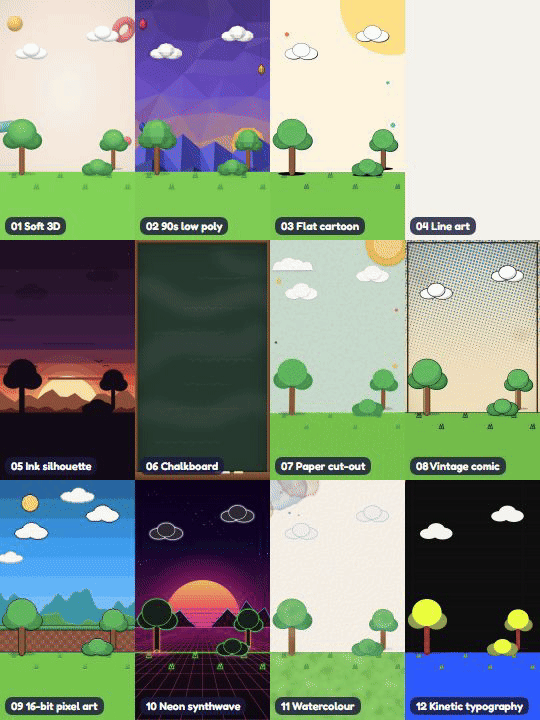

# unfaced

*Questa è una traduzione: se è diversa dalla [versione inglese](../../../README.md), fa fede quella inglese.*

**Crea e gestisci pagine social faceless con il tuo coding agent.**

**Leggi in:** [English](../../../README.md) · Italiano · [Español](../es/README.md) · [Français](../fr/README.md) · [Português (Brasil)](../pt-BR/README.md)

Scegli stili, tipi di script, hook e voci numerati, salvali in un profilo della pagina e trasforma idee di una riga in video verticali finiti per Reels, TikTok e Shorts. Gratis di base; i servizi a pagamento sono facoltativi.



## Cosa puoi fare

Chiedilo al tuo agent, con parole tue:

| Tu dici | Cosa succede |
|---|---|
| "Apri una pagina di curiosità sorprendenti sui gatti, in italiano" | **page-setup** ti fa qualche domanda (o sceglie tutto lui se dici "scegli tu"), scrive `page.yaml` partendo dai cataloghi numerati e può creare una mascotte che resta identica in ogni video. |
| "Dammi idee per la prossima settimana" | **video-ideas** scrive in `ideas.md` dieci idee verificate, due o tre serie ricorrenti e un calendario. |
| "Come faccio quello sull'impastare?" | **video-recommend** ti propone 2–3 combinazioni (tipo di script, hook, finale, durata...) con un hook d'esempio per ciascuna. |
| "Fallo" | **video-make** fa le ricerche e scrive lo script, **si ferma per la tua approvazione**, poi registra la voce, disegna le scene, fa il render, lancia i controlli automatici e fa guardare ogni frame a un agent revisore indipendente prima di consegnarti `video.mp4`. |
| "Preparalo per la pubblicazione" | **video-package** genera `cover.png` e scrive `post.md`: didascalie, hashtag e un titolo per ogni piattaforma. |
| "Ecco i miei numeri, cosa dovrei cambiare?" | **page-results** confronta i video in `results.md` per piattaforma e per ogni scelta fatta, e ti suggerisce al massimo tre modifiche, ognuna con un modo per testarla. |

unfaced non pubblica mai nulla. Crea dei file; a pubblicarli sei tu, o il tuo strumento di programmazione dei post.

## Installazione

**Non hai mai usato un terminale?** Segui [Per iniziare, senza scrivere codice](getting-started.md): l'app desktop di Claude, una cartella e qualche frase da scrivere a Claude.

**Claude Code** (supporto completo):

```text
/plugin marketplace add dodoshell/unfaced
/plugin install unfaced@unfaced
```

Il primo comando che ha bisogno del motore lo installa in `~/.unfaced/` (servono git, Node 22+ e circa 1 GB per il modello vocale, whisper e il browser di render).

**Altri agent** (al meglio delle possibilità): `npx skills add dodoshell/unfaced`. Le skill sono semplici istruzioni più un launcher Node; se un agent non ha i subagent, la revisione gira invece in una sessione nuova.

**Da un clone**: `npm run setup`, poi usa direttamente la CLI (vedi sotto). Le skill dentro il clone la usano già; per far puntare un plugin installato al tuo clone, imposta `UNFACED_LIB` sulla sua cartella.

## Cataloghi

Ogni voce è pronta all'uso. `unfaced list <kind>` elenca un catalogo, `unfaced show <kind> <number>` mostra la guida di una voce e `unfaced gallery` crea una pagina che le mostra tutte, con un poster per ogni stile.

| Catalogo | Voci |
|---|---|
| Stili (12) | 3D morbido, low poly anni '90, cartoon flat, line art, silhouette a inchiostro, lavagna, carta ritagliata, fumetto vintage, pixel art 16-bit, neon synthwave, acquerello, tipografia cinetica |
| Tipi di script (10) | costruiscilo, classifica top N, mito o realtà, e se..., una storia in 60 secondi, risposta sorprendente, come funziona, X contro Y, lo sapevi che, mini storia |
| Hook (15) | domanda scioccante, numero assurdo, "lo stai facendo male", immagine impossibile, POV, parti dal climax... ognuno con regole e tre esempi |
| Voci (8) | documentario calmo, energica, narratore, sussurro, impassibile, calda e amichevole, conduttore del TG, nessuna (solo testo) |
| Sottotitoli (6) | karaoke parola per parola, grassetto al centro, macchina da scrivere, sottopancia minimale, contorno pop, parola chiave evidenziata |
| Musica (8) | suspense, epica, lo-fi, allegra, giocosa, emozionante, mistero (tutte generate via codice, MIT), nessuna |
| Finali (6) | loop senza stacchi, cliffhanger, domanda nei commenti, segui per la parte 2, battuta finale, ritorno all'hook |
| Durate (4) | 15, 30, 45 e 60 secondi, con regole sul ritmo |

## Esempi

- [`examples/pages/`](../../../examples/pages/): tre pagine da copiare. *Curious Cats* (cartoon flat, curiosità sui gatti) con due video già fatti: script, tempi delle parole, piani e risultati dei controlli, pronti per un nuovo render con `unfaced make`; *Space in 60* (neon synthwave, una grande idea sullo spazio al minuto, cliffhanger) e *Piccola Storia* (acquerello, in italiano: le piccole storie dietro parole e oggetti di tutti i giorni), ognuna con mascotte, idee e calendario.
- [`examples/combos/`](../../../examples/combos/): cinque video d'esempio di circa 30 secondi; nessuna coppia condivide stile, tipo di script, hook, voce, stile dei sottotitoli, mood musicale o finale. Script, piani e controlli sono qui; gli MP4 sono allegati a ogni release.
- [`examples/scripts/`](../../../examples/scripts/): uno `script.md` completo per ogni tipo di script.
- [`examples/hooks/`](../../../examples/hooks/): ogni hook con tre esempi da nicchie diverse. Il reel degli hook, con ogni hook recitato sopra lo stile successivo, è allegato a ogni release.

## Come funziona

- **Gratis e in locale**: `script.md` → voce (Kokoro, offline; inglese e italiano con supporto completo) → tempi delle parole (whisper.cpp) → scene precise al frame → musica mixata sotto la voce → un MP4 1080×1920 a 30 fps renderizzato con Remotion. Niente API key, niente GPU.
- **A pagamento solo se vuoi**: ElevenLabs per la voce, Pexels (con una chiave gratuita) per le foto stock, Replicate per immagini e clip generate (`unfaced generate`). Le chiavi vanno in `.env`, mai in `page.yaml`; senza chiave si usa la strada gratuita e unfaced te lo dice.
- **Un sistema di personaggi**: otto specie e dieci pose, con gli stessi movimenti in ogni stile, così la mascotte della pagina resta sempre coerente.
- **Scene su misura per il video**: quando un passaggio ha bisogno di un diagramma o di un momento preciso, l'agent scrive una piccola scena React apposta (`docs/formats/scenes.md`); per tutto il resto si usano le scene dello stile.
- **Due revisioni**: controlli automatici (testo sovrapposto, safe zone delle piattaforme, sottotitoli in sync con la voce entro 2 frame, frame neri o bloccati, volume, parole tagliate) e un agent revisore indipendente che vede solo i file, mai la conversazione che ha prodotto il video.

## La CLI

```bash
npm run unfaced -- page examples/pages/curious-cats            # check a page profile
npm run unfaced -- make examples/pages/curious-cats/videos/why-cats-purr
npm run unfaced -- frames examples/pages/curious-cats/videos/why-cats-purr --every 1s
npm run unfaced -- cover examples/pages/curious-cats/videos/why-cats-purr
npm run unfaced -- results my-page                             # compare the posted videos' numbers (results.md)
npm run unfaced -- docs script                                 # file formats: page, script, mascot, scenes, review, post, results
npm run unfaced -- doctor                                      # what is missing from the install
npm run unfaced -- help                                        # every command
```

Le skill e l'agent revisore hanno degli eval in [`evals/`](../../../evals/README.md), da lanciare con `claude plugin eval`.

## Una pagina sul disco

```text
my-page/
  page.yaml              the profile: language, niche, style, script types, voice, ...
  brand/mascot/          the mascot: mascot.json, mascot.md, reference.png
  ideas.md               ideas, series and the calendar
  results.md             how the posted videos did
  videos/
    why-cats-purr/
      script.md          hook, body beats, ending (docs/formats/script.md)
      scenes/            optional scene code for this video
      inbox/             optional images, clips or a voice-over you hand off
      video.mp4          made by unfaced make
      check.json         the automatic checks
      review.md          the independent review
      cover.png, post.md ready to post
```

## Contribuire

Nuovi stili, tipi di script e hook sono i benvenuti: leggi [`CONTRIBUTING.md`](../../../CONTRIBUTING.md).

## Licenza

MIT. Gli asset di terze parti mantengono le proprie licenze, elencate in [`LICENSES/`](../../../LICENSES/README.md).
Il render usa [Remotion](https://www.remotion.dev), gratuito per privati e aziende fino a tre persone; le aziende più grandi hanno bisogno di una [licenza Remotion](https://www.remotion.dev/license).
