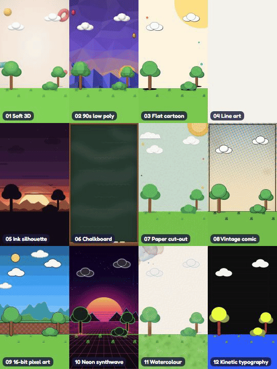
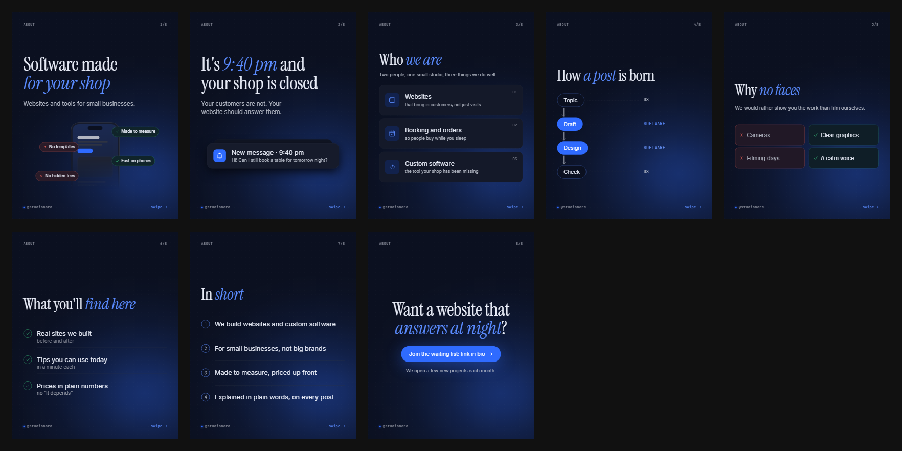

# unfaced

*Esta é uma tradução; se ela for diferente da [versão em inglês](../../../README.md), vale a versão em inglês, que está sempre atualizada.*

**Crie e gerencie páginas faceless nas redes sociais com o seu agente de programação.**

**Leia em:** [English](../../../README.md) · [Italiano](../it/README.md) · [Español](../es/README.md) · [Français](../fr/README.md) · Português (Brasil)

Escolha estilos, tipos de roteiro, ganchos e vozes numerados, salve tudo num perfil de página e transforme ideias de uma linha em vídeos verticais prontos para Reels, TikTok e Shorts, ou em posts estáticos (carrosséis, imagens únicas, PDF para o LinkedIn, stories) com o visual de uma marca. Gratuito por padrão; serviços pagos são opcionais.



## O que você pode fazer

Peça ao seu agente, com as suas palavras:

| Você diz | O que acontece |
|---|---|
| "Comece uma página faceless no TikTok sobre curiosidades surpreendentes de gatos, em português" | **page-setup** faz algumas perguntas (ou escolhe tudo se você disser "você escolhe"), escreve o `page.yaml` a partir dos catálogos numerados e pode criar um mascote que fica igual em todos os vídeos. |
| "Me dá ideias para a semana que vem" | **video-ideas** escreve dez ideias verificadas, duas ou três séries recorrentes e um calendário no `ideas.md`. Cada ideia diz se é um reel, um carrossel ou um story, e por quê. |
| "Como eu faço aquele sobre sovar a massa?" | **video-recommend** sugere 2–3 combinações (tipo de roteiro, gancho, final, duração...) com um exemplo de gancho para cada uma. |
| "Pode fazer" | **video-make** pesquisa e escreve o roteiro, **para e espera a sua aprovação**, depois grava a voz, desenha as cenas, renderiza, roda as verificações automáticas e pede para um agente revisor independente olhar cada frame antes de te entregar o `video.mp4`. |
| "Faça um carrossel sobre os nossos três serviços" | **post-make** escreve o texto slide por slide, **para e espera a sua aprovação**, depois cria os slides (e um PDF para o LinkedIn), roda as verificações e pede a um agente revisor independente que olhe cada slide. |
| "Aqui estão prints do nosso perfil" | **page-setup** lê os prints e monta um rascunho do perfil da página, marca incluída (handle, cores, fontes, tom), e depois pergunta o que não consegue decidir sozinho. Nada é salvo até você concordar. |
| "Deixa pronto para postar" | **video-package** renderiza o `cover.png` e escreve o `post.md`: legendas, hashtags e um título para cada plataforma. |
| "Aqui estão os meus números, o que eu devo mudar?" | **page-results** compara os vídeos do `results.md` por plataforma e por cada escolha feita, e sugere no máximo três mudanças, cada uma com um jeito de testar. |

O unfaced nunca posta nada. Ele cria arquivos; quem publica é você, ou a sua ferramenta de agendamento.

## Instalação

**Nunca usou um terminal?** Siga o guia [Primeiros passos, sem programar](getting-started.md): o app do Claude para desktop, uma pasta e algumas frases para o Claude.

**Claude Code** (suporte principal):

```text
/plugin marketplace add dodoshell/unfaced
/plugin install unfaced@unfaced
```

O primeiro comando que precisa do motor instala ele em `~/.unfaced/` (git, Node 22+ e cerca de 1 GB para o modelo de voz, o whisper e o navegador de renderização).

**Outros agentes** (sem garantia total): `npx skills add dodoshell/unfaced`. As skills são instruções simples e um launcher em Node; quando o agente não tem subagentes, a revisão roda numa sessão nova.

**A partir de um clone**: `npm run setup` e depois use a CLI diretamente (veja abaixo). As skills dentro do clone usam ela; para apontar um plugin instalado para o seu clone, defina `UNFACED_LIB` com a pasta dele.

## Catálogos

Todos os itens estão prontos para usar. `unfaced list <kind>` lista um catálogo, `unfaced show <kind> <number>` mostra o guia de um item e `unfaced gallery` gera uma página que mostra todos eles, com um pôster de cada estilo.

| Catálogo | Itens |
|---|---|
| Estilos (13) | 3D suave, low poly anos 90, cartoon flat, line art, silhueta em nanquim, quadro-negro, recorte de papel, quadrinho vintage, pixel art 16 bits, synthwave neon, aquarela, tipografia cinética; e o 13 Night tech, que desenha posts (os vídeos estão previstos) |
| Tipos de post (6) | dicas e erros, como funciona, quem somos, serviços e preços, antes e depois, anúncio |
| Tipos de roteiro (10) | monte isso, contagem regressiva top N, mito ou verdade, e se, história em 60 segundos, resposta surpreendente, como funciona, X vs Y, você sabia, mini-história |
| Ganchos (15) | pergunta chocante, número absurdo, "você está fazendo errado", imagem impossível, POV, começar pelo clímax... cada um com regras e três exemplos |
| Vozes (8) | documentário calmo, enérgica, contadora de histórias, sussurro, deadpan, calorosa e amigável, âncora de telejornal, nenhuma (só texto) |
| Legendas (6) | karaokê palavra por palavra, negrito centralizado, máquina de escrever, terço inferior minimalista, contorno pop, palavra-chave destacada |
| Música (8) | suspense, épica, lo-fi, animada, divertida, emocionante, mistério (todas feitas em código, MIT), nenhuma |
| Finais (6) | loop contínuo, cliffhanger, pergunta nos comentários, siga para a parte 2, punchline, retorno ao gancho |
| Durações (4) | 15, 30, 45 e 60 segundos, com regras de ritmo |

## Posts

Um post é uma pasta com um `slides.md`: o texto, slide por slide. O unfaced diagrama o texto no estilo e na marca da página e cria os slides em PNG, mais um PDF para o LinkedIn e uma `grid.png` para ver todos lado a lado.



Diga o formato conforme a finalidade do post; o tamanho o unfaced já conhece:

| Formato | Tamanho | Slides | Você recebe |
|---|---|---|---|
| `instagram-carousel` | 1080×1350 | de 2 a 10 | PNGs |
| `instagram-post` | 1080×1350 (1080×1080 com `square: true`) | 1 | um PNG |
| `linkedin-carousel` | 1080×1350 | de 2 a 12 | um PDF, e os PNGs |
| `story` | 1080×1920 | de 1 a 10 | PNGs |

Um mesmo `slides.md` pode ser feito em vários formatos: o layout se adapta e o texto fica igual. A marca da página (handle, site, logo, fontes, tom, palavras para usar e para evitar) coloca o handle, o logo e as fontes nos slides e guia todos os textos que os agentes escrevem, legendas incluídas, onde entra o site. Tipos de slide: cover, point, list, steps, compare, stat, quote, image, cta e custom, para um slide que precisa de código próprio. Veja `unfaced docs slides` e `unfaced docs brand`.

O 13 Night tech é o primeiro estilo que desenha posts, com elementos gráficos prontos para usar: chips, um fluxo de passos, um celular, uma notificação e um pequeno conjunto de ícones. Os estilos de 1 a 12 por enquanto só fazem vídeos. Uma página completa com um carrossel: [`examples/pages/studio-nord/`](../../../examples/pages/studio-nord/).

## Exemplos

- [`examples/pages/`](../../../examples/pages/): quatro páginas para copiar. *Studio Nord* (night tech, um pequeno estúdio web) tem um bloco de marca e um carrossel "quem somos" em `posts/about-us/`. *Curious Cats* (cartoon flat, curiosidades de gatos) com dois vídeos prontos: roteiros, tempos de cada palavra, planos e resultados das verificações, prontos para renderizar de novo com `unfaced make`; *Space in 60* (synthwave neon, uma grande ideia sobre o espaço por minuto, cliffhangers) e *Piccola Storia* (aquarela, em italiano: as pequenas histórias por trás de palavras e objetos do dia a dia), cada uma com mascote, ideias e calendário.
- [`examples/combos/`](../../../examples/combos/): cinco vídeos de exemplo com uns 30 segundos; nenhum repete estilo, tipo de roteiro, gancho, voz, estilo de legenda, clima musical ou final. Os roteiros, planos e verificações estão aqui; os MP4 vão anexados em cada release.
- [`examples/scripts/`](../../../examples/scripts/): um `script.md` completo para cada tipo de roteiro.
- [`examples/hooks/`](../../../examples/hooks/): todos os ganchos com três exemplos de nichos diferentes. O reel de ganchos, com cada gancho narrado no estilo seguinte, vai anexado em cada release.

## Como funciona

- **Gratuito e local**: `script.md` → voz (Kokoro, offline; inglês e italiano com suporte principal) → tempos de cada palavra (whisper.cpp) → cenas sincronizadas no frame exato → música mixada por baixo da voz → um MP4 de 1080×1920 a 30 fps renderizado com Remotion. Sem chave de API, sem GPU.
- **Pago só se você quiser**: ElevenLabs para a voz, Pexels (chave gratuita) para fotos de banco de imagens, Replicate para imagens e clipes gerados (`unfaced generate`). As chaves ficam no `.env`, nunca no `page.yaml`; sem chave, o caminho gratuito é usado e o unfaced avisa.
- **Um sistema de personagens**: oito espécies e dez poses, com o mesmo movimento em todos os estilos, para que o mascote da página fique sempre fiel ao modelo.
- **Cenas próprias de cada vídeo**: quando um momento pede um diagrama ou uma cena específica, o agente escreve uma pequena cena em React para ele (`docs/formats/scenes.md`); todo o resto usa as cenas do estilo.
- **Duas revisões**: verificações automáticas (texto sobreposto, a área segura das plataformas, legendas sincronizadas com a voz com no máximo 2 frames de diferença, frames pretos ou congelados, volume, palavras cortadas) e um agente revisor independente que vê só os arquivos, nunca a conversa que gerou o vídeo.

## A CLI

```bash
npm run unfaced -- page examples/pages/curious-cats            # check a page profile
npm run unfaced -- make examples/pages/curious-cats/videos/why-cats-purr
npm run unfaced -- frames examples/pages/curious-cats/videos/why-cats-purr --every 1s
npm run unfaced -- cover examples/pages/curious-cats/videos/why-cats-purr
npm run unfaced -- post examples/pages/studio-nord/posts/about-us      # render a carousel (--format <name> for one format)
npm run unfaced -- demo 13 --post                              # the sample post in a style
npm run unfaced -- results my-page                             # compare the posted videos' numbers (results.md)
npm run unfaced -- docs slides                                 # file formats: page, brand, script, slides, mascot, scenes, review, post, results
npm run unfaced -- list post-type                              # the post types
npm run unfaced -- doctor                                      # what is missing from the install
npm run unfaced -- help                                        # every command
```

As skills e o agente revisor têm evals em [`evals/`](../../../evals/README.md), que rodam com `claude plugin eval`.

## Uma página no disco

```text
my-page/
  page.yaml              the profile: language, niche, style, script types, voice, ...
  brand/                 optional: logo, fonts, and mascot/ (mascot.json, mascot.md, reference.png)
  ideas.md               ideas, series and the calendar
  results.md             how the posted videos did
  videos/
    why-cats-purr/
      script.md          hook, body beats, ending (docs/formats/script.md)
      scenes/            optional scene code for this video
      inbox/             optional images, clips or a voice-over you hand off
      video.mp4          made by unfaced make
      check.json         the automatic checks
      review.md          the independent review
      cover.png, post.md ready to post
  posts/
    about-us/
      slides.md          the text, slide by slide (docs/formats/slides.md)
      custom/, inbox/   optional slide code and photos
      slide-01.png ...   made by unfaced post (post.pdf for LinkedIn, grid.png, check.json)
      review.md, post.md the independent review; captions, hashtags and alt text
```

## Como contribuir

Novos estilos, tipos de roteiro, tipos de post, tipos de slide e ganchos são bem-vindos: veja o [`CONTRIBUTING.md`](../../../CONTRIBUTING.md).

## Licença

MIT. Os recursos de terceiros mantêm as suas próprias licenças, listadas em [`LICENSES/`](../../../LICENSES/README.md).
A renderização usa o [Remotion](https://www.remotion.dev), que é gratuito para pessoas físicas e empresas de até três pessoas; empresas maiores precisam de uma [licença do Remotion](https://www.remotion.dev/license).
